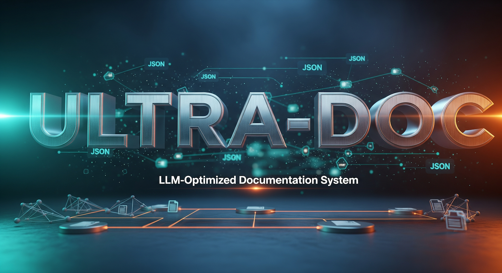

# Ultra-Doc 2.0



Ultra-Doc is a Claude Code plugin for maintaining two documentation folders:
`context_for_llms/` contains source Markdown and JSON indexes;
`context_for_humans/` contains generated human overviews. Node scripts handle
indexing, formatting, reference checks, and reporting. A Claude session can use
the skill to read code and write or correct prose.

The humanizer is a local, deterministic Markdown transformation. It does not
call an AI service, and its output needs review, especially code examples.
Passing validation checks paths and simple example patterns; it does not prove
that a document's behavioral claims match the source code.

## Install the Claude Code plugin

You need Claude Code with plugin support, Node.js, and Git on your `PATH`.
The local procedures were checked with Node.js 22.22.2 and Claude Code 2.1.318
on Linux arm64. The package declares Node.js >=14; older versions were not
verified in this audit. There are no npm dependencies or required API keys for
the deterministic scripts.

Run these commands in your terminal to add the marketplace and install the
plugin in your user configuration:

```bash
claude plugin marketplace add justfinethanku/ultra-doc
claude plugin install ultra-doc@ultra-doc-marketplace
claude plugin list
```

The equivalent commands inside Claude Code are `/plugin marketplace add
justfinethanku/ultra-doc` and `/plugin install
ultra-doc@ultra-doc-marketplace`. Restart Claude Code after installation. Open
your target repository and select `/ultra-doc:ultra-doc` from command completion
to load the skill. This is a Claude command, not a Bash executable. Ask Claude
to initialize the project using the [installation flow](skills/ultra-doc/SKILL.md#installation-flow),
preserving your existing `CLAUDE.md` and documentation.

Plugin installation registers the skill, command, and [documentation health
hook](#automatic-hooks); it does not create project documentation. The Node
orchestrator has no `install` subcommand: without
`.ultra-doc.config.json` it prints setup advice and exits without creating files.
The terminal procedure below initializes a disposable project explicitly. The
marketplace installation was exercised locally; the conversational Claude
initialization flow was not exercised by that check.

To update an existing installation, run `claude plugin marketplace update
ultra-doc-marketplace`, then `claude plugin update
ultra-doc@ultra-doc-marketplace`, and restart Claude Code. Update the project
configuration's version after reviewing the new version's setup instructions.
See the official [plugin installation guide](https://code.claude.com/docs/en/plugins/install)
for installation scopes and plugin management.

## Run a local example

This procedure uses a separate plugin checkout and a new example project. Start
in an empty working directory with Git and Node.js available. Do not reuse an
existing `ultra-doc-example` directory: the example writes its own guide and
configuration.

Clone the plugin, run its dependency-free tests, and remember the script path:

```bash
git clone https://github.com/justfinethanku/ultra-doc.git
cd ultra-doc
npm test
export ULTRA_DOC_SCRIPTS="$PWD/skills/ultra-doc/scripts"
```

Create the example project beside the checkout:

```bash
mkdir ../ultra-doc-example
cd ../ultra-doc-example
mkdir -p context_for_llms context_for_humans reports src
printf 'export const answer = 42;\n' > src/example.js
cat > .ultra-doc.config.json <<'JSON'
{
  "setup_level": "standard",
  "audience": "balanced",
  "ci_integration": false,
  "version": "2.0.0"
}
JSON
cat > context_for_llms/guide.md <<'MARKDOWN'
# Example guide

## Source

`src/example.js` exports the answer constant.
MARKDOWN
ULTRA_DOC_AUTO_ACTION=sync node "$ULTRA_DOC_SCRIPTS/orchestrator.mjs"
```

Expect `Sync Complete`, a successful validation result, and generated
`SECTIONS.json`, `CODE_POINTERS.json`, `RELATIONSHIPS.json`, `DOC_STATE.json`,
`VALIDATION.json`, and `INDEX.md` in `context_for_llms/`. Human overviews appear
in `context_for_humans/`, and a summary appears in `reports/`.
The example has no Git history, so tracking falls back to file modification
times and Git-based changelog detection has no changes to record. Git diagnostics
in that case do not by themselves mean the pipeline failed; check its exit code.

The scripts use **the current working directory as the target project**. Keep
`ULTRA_DOC_SCRIPTS` pointed at the plugin scripts while changing directories to
the project you want to maintain. For your own project, create the three output
directories, configuration, and real source documentation first. Run `.mjs`
files with `node`, not `bash`.

## 🛠️ How It Works

### Project file containment

Run scripts with the intended project as the current working directory. All
project content reads, writes, appends, directory creation and enumeration use
`skills/ultra-doc/scripts/project-fs.mjs`, including JSON overlays and reports.
The helper checks lexical and real-path containment for the target and every
parent up to that root, including existing parents of new outputs. It refuses
symlinks in any component, even links pointing inside the project, and refuses
non-regular file targets. Opens use `O_NOFOLLOW` when Node exposes it, and file
identity is checked again after opening, before truncation.

Directory enumeration skips symlinked files and directories (including dangling
links and cycles) with a `Skipping unsafe project entry` warning. Git source
enumeration uses the same policy. Explicitly selected unsafe paths, such as a
changed Git document or an output file/directory, fail with an
`Unsafe project path` error. Replace these links with ordinary project files or
directories before retrying. Humanizer debug prompts now live in the project's
`logs/ultra-doc/`, rather than the plugin installation's `skills/logs/` directory.

The checks protect against symlinks present when a script runs and recheck paths
after opening; they are not a sandbox against another process concurrently
renaming directory trees. Run sync in a project you control.

### Metadata and validation

A full sync tracks referenced source changes, refreshes changed document
timestamps, applies formatting fixes, writes the lint digest, builds overlays,
generates human overviews, checks parity, and writes a changelog and summary.
Accuracy validation runs after metadata sync. Review the exit code and
`VALIDATION.json`; the metadata stage's `Sync Complete` message alone does not
mean the later validation passed.

The scripts scan top-level Markdown in `context_for_llms/`. Inline backtick
references to `.mjs`, `.js`, `.ts`, `.md`, and `.json` files become code pointers.
The generated pointer file contains a `pointers` object; consumers also accept
the older flat mapping. For accurate references, use paths relative to the
**target project**, not the plugin installation.

Source Markdown remains yours to maintain. Generated human overviews can be
overwritten when their machine documents are newer. Scripts do not automatically
rewrite factual claims, commit files, or enable CI.

## Choose a workflow

Run the orchestrator from the initialized target project:

```bash
ULTRA_DOC_AUTO_ACTION=summary node "$ULTRA_DOC_SCRIPTS/orchestrator.mjs"
```

Replace `summary` with `sync`, `quick`, or `validate` for other workflows.
`summary` still refreshes `DOC_STATE.json`; it is not a read-only command.
Without a valid preset, stale docs trigger full sync. Otherwise a terminal menu
is shown; without a TTY, its recommended action runs automatically.

See [Operate and troubleshoot Ultra-Doc](docs/operations.md) for each workflow's
side effects, output locations, exit behavior, configuration, and recovery.

## Automatic hooks

Claude Code loads `hooks/hooks.json` using its [standard plugin
layout](https://code.claude.com/docs/en/plugins-reference#hooks). After installing
version 2.0.1 or later and restarting Claude Code, inspect the registered event:

```bash
claude plugin details ultra-doc@ultra-doc-marketplace
```

Expect `Hooks (1)  PostToolUse`. Its `Edit|Write` tool matcher runs a Node handler
after a successful `Edit` or `Write`. The handler only checks top-level `.md`
files in `context_for_llms/`, excluding generated `INDEX.md`, in a project with
`.ultra-doc.config.json`. Other files and uninitialized projects are skipped.

The handler reads Claude Code's [documented JSON input on
stdin](https://code.claude.com/docs/en/hooks#posttooluse-input), including `cwd`
and `tool_input.file_path`. It invokes the plugin's `analyze-doc-state.mjs` with
that `cwd` as the working directory. The check refreshes only
`context_for_llms/DOC_STATE.json` and returns a short context message to Claude;
it does not sync metadata indexes, rewrite prose, or generate human overviews.
Use an explicit workflow for those operations.

The analyzer has a two-second timeout; incomplete stdin times out after one
second, and payloads over 1 MiB are skipped with a warning. Claude Code also
limits the hook to five seconds with `onFailure: "continue"`. Malformed input,
unsafe project paths, failed analysis, and timeouts produce a warning (stderr
and a JSON `systemMessage`) and exit zero so the user action can continue. The
hook does not start a Claude session or make an API request.

Verification used a fresh temporary `CLAUDE_CONFIG_DIR` and a local marketplace
installation with Claude Code 2.1.318. Documented `PostToolUse` payloads for both
`Write` and `Edit` were piped to the installed hook command; each refreshed
`DOC_STATE.json` in the temporary project and returned the expected context
message. This was a stdin fixture check, not a conversational Claude session.
There are no commit, deployment-prompt, session-start, or idle hooks. Changes
made through Bash or outside Claude Code do not trigger this tool matcher.

## Develop and verify

Run `npm test` in the plugin checkout. It executes real CLI regression fixtures
for subprocess safety, metadata sync, pointer consumption, change tracking,
project containment, and hook input, output, failure, and timeout behavior.
There is no build step or configured GitHub Actions workflow. `npm install` is
not needed for these scripts or tests.

Run setup and sync examples in a disposable target project because they write
files. Inspect `git diff` in a real target project before committing generated
output. The older `context_for_llms/` and `context_for_humans/` documents include
historical descriptions; use this README and the operations guide for the
current executable procedure.

## License

MIT. See [LICENSE](LICENSE).
